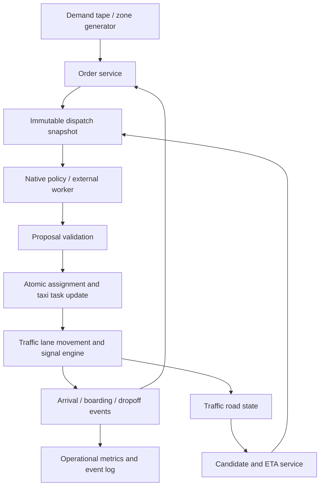

# Taxi integration and experimental dispatch design

Status: architecture target. The core Taxi/Traffic modes and dispatch extensions are now implemented; see `taxi-implementation.md` for the delivered contract, validation and remaining design stages.
Date: 2026-11-14.

## Decision

Integrate ride-dispatch-simulator's demand, order lifecycle, fleet management,
policy interface and experiment methodology into traffic. Traffic remains the
single authority for time, directed lane routing, signals, queues, ramps and
vehicle movement. Keep the existing Electron window, Go backend and executable
location. Preserve the current traffic-only mode.

Use native Go policies for built-in algorithms and a versioned process protocol
for experimental Python, Go or other executables. Both implement the same logical
contract. Do not introduce a second vehicle simulator or copy the source city's
undirected router. Algorithm code proposes assignments; only the host commits them.

## Sources and reuse boundary

| Existing source | Reuse | Required adaptation |
|---|---|---|
| ride-dispatch-simulator/backend/app/models/domain.py | Order/vehicle operational fields | Separate physical vehicles from passengers; persistent fleet |
| backend/app/demand/generator.py | Time-dependent spatial arrivals and independent demand RNG | Zones and curb stops on traffic's map; explicit units |
| backend/app/dispatch/base.py, registry.py | Policy registration and disjoint proposals | Versioned value-only contract; factory per run |
| backend/app/dispatch/{nearest_driver,fifo,greedy,hungarian,batch,score_based}.py | Baseline behavior | Port to Go or run in isolated experimental worker; compare on identical inputs |
| backend/app/simulation/engine.py | Cancellation, supply changes, relocation, counters | All transitions driven by traffic's actual arrival events |
| backend/app/simulation/benchmark.py | Seeded scenario comparison | Fixed demand tapes, multiple seeds, resource budgets, failure accounting |
| traffic/internal/road_scheduling/simulation.go | Clock, following, lane changes and turning | Extract shared road-agent movement; attach taxi task completion |
| traffic/internal/road_scheduling/routing.go | Lane-valid route search and occupancy costs | Current-position routing and calibrated time estimates |
| traffic/internal/infrastructure/road/types.go | Directed roads, elevation, access flags, kilometer scale | Stop and demand-zone definitions |
| traffic/internal/server/server.go and web/ | API, stream, canvas and floating UI | Taxi commands, views, metrics and experiment controls |

Source algorithm names describe implementations, not guaranteed optimal service.
Hungarian minimizes a supplied assignment matrix, not overall future wait or
network congestion. Score Based currently uses greedy selection of normalized
multi-objective costs. Preserve this distinction in labels and experiments.

## Ownership and components



The simulation owner serializes all state mutation. Policy code never receives
live pointers, locks, graph mutation methods, or access to the simulation RNG.
The frontend renders server snapshots and sends commands only. Keep the existing
stream transport; a separate WebSocket service is unnecessary for integration.

Proposed packages (new paths, not existing APIs):

```text
internal/mobility/domain/       orders, taxis, stops, tasks, events
internal/mobility/demand/       zones, demand tapes, independent RNG
internal/mobility/fleet/        lifecycle, supply changes, relocation
internal/mobility/routing/      current-position routes, candidate/ETA estimates
internal/operations/taxi/dispatch/             versioned contract, registry, proposal validator
internal/operations/taxi/dispatch/builtin/     deterministic native baselines
internal/operations/taxi/dispatch/worker/      framed protocol, deadlines, process lifecycle
internal/algorithms/experiments/           isolated runs, replay, metrics, exports
experiments/dispatch/           trusted local experimental policy source
configs/taxi/                  scenarios, stop/zone definitions, worker manifests
```

## Entity and lifecycle model

A road agent owns position, directed way, lane, along-distance, speed, route,
lane-change/turn state and elevation. Separate pedestrians, private-trip agents
and persistent taxi vehicles while sharing the existing road movement engine.
Do this incrementally with traffic-only regression checks; do not duplicate
following, collision reservations or signal decisions in the taxi package.

A Taxi links a road-agent ID to an operational state, active order/task,
availability, earnings and accumulated occupied/empty distance. A passenger/order
is a separate entity. Boarding hides the passenger's separate map marker but does
not create another road vehicle. Fleet size must not inflate passenger population.

Operational states:

```text
Idle -> ToPickup -> Boarding -> WithPassenger -> Alighting -> Idle
Idle <-> Repositioning
Idle/Repositioning -> Offline
Busy + retire_requested -> finish current service -> Offline
```

Physical state remains orthogonal: Driving, Waiting, Turning and Parked can each
coexist with the appropriate operational state. Waiting at a signal must not make
a busy taxi dispatchable. Pickup/alighting dwell durations are scenario settings.

Order states: Waiting -> Assigned -> Boarding -> InService -> Completed.
Waiting or Assigned may become Cancelled at its configured pickup deadline.
Boarding claims the order atomically and prevents timeout from releasing the taxi.
Default pickup deadline: 600 simulation seconds, configurable per scenario.
No pooling, passenger transfers or voluntary busy-taxi reassignment in contract v1.

At a tick boundary process arrival events and timeout events in timestamp order.
For equal timestamps, a valid pickup arrival at the deadline wins; otherwise cancel.
After cancellation release the order, retain the taxi's physical position and
finish any committed lane change/turn before applying the next task. Every terminal
transition and revenue settlement is idempotent and logged once.

## Maps, stops, routing and units

Add Stop records: id, zone_id, directed way_id, lane, along_m, position derived
from geometry, capacity, dwell policy and enabled vehicle classes. Validate stops
against lane count, usable road length, intersection buffers and trip-access rules.
Stops must be on accessible surface roads, excluding mainline, bridge and ramp
roles. An opposite-direction stop requires its own directed anchor and legal route.
Use curb bays for initial implementation; explicitly model entry, occupancy and
exit-gap acceptance. Full bays create a waiting/approach task, never overlapping
parked cars or instantaneous boarding. Any queue that blocks a lane must enter the
normal collision model.

Add zone polygons, land-use type, hourly origin weights and destination weights.
For the four-cell map add surface local streets and stop pairs inside the four
blocks; the interchange network alone is not sufficient urban taxi service access.
Keep a smaller set of validated stops on the original map for initial integration.

Use meters, simulation seconds and m/s internally. Convert km and km/h at API/UI
boundaries. traffic currently maps 1000 world units to 1 km; the source simulator
uses 8 meters per world unit. Do not transplant its coordinates or speed values
without conversion. Audit traffic speed and vehicle dimensions before presenting
calibrated physical travel-time or economic results.

Routing begins at the actual lane/along position and respects any already
committed connector. Cost includes remaining distance on the current road and
legal movement constraints; a target already passed on the same road may require
a legal circuit. Same-road forward targets should not require a graph round trip.
The current occupancy-weighted route cost is not automatically an ETA in seconds.
Provide an ETA estimator with free-flow traversal, observed queue/signal delay and
an explicit model version. Recalculate pickup predictions for display; retain the
assignment-time prediction separately for error analysis. Arrival events, not ETA
countdown expiry, advance the order state.

## Dispatch contract v1

A policy is selected by ID and configured before a run. Metadata includes ID,
version, parameter schema/defaults, seed support, supported contract version,
implementation kind and code/environment fingerprint. A registry stores factories,
not shared policy instances. Each simulation/benchmark obtains an isolated instance.
Reject duplicate IDs, incompatible versions and invalid configuration at startup.

Illustrative Go interface (design contract, not compilable scaffolding):

```go
type Factory func(Config, uint64) (Policy, error)
type Policy interface {
    Decide(context.Context, Input) (Proposal, error)
    Close() error
}
// Registry.Register(metadata, factory)
// All DTOs are detached value snapshots; no *sim.Simulation or mutable graph.
```

Input fields:

| Field | Meaning |
|---|---|
| contract_version, run_id, epoch, request_id | Protocol and run/reset identity |
| snapshot_revision, sim_time_s | Observation identity and time |
| decision_deadline_s | Scheduled simulation-time commit boundary |
| config, policy_seed | Validated parameters and deterministic private randomness |
| vehicles[] | Eligible Idle/Repositioning taxis; position anchor, idle duration, income, zone |
| orders[] | Waiting orders; stops, request time, pickup deadline, destination |
| candidates[] | Reachable vehicle/order pairs with pickup_distance_m, pickup_eta_s, cost version |
| zone_stats[] | Observed supply/demand and declared forecasts, with timestamps |
| map_version, cost_model_version | Reproducible map and estimator identity |

IDs and numeric values use fixed field definitions; serialize missing optional
values as null or omit according to the schema. Unreachable pairs are absent,
not Infinity/NaN or a misleading zero. Sort arrays by stable IDs. Do not expose
future demand tape entries. Forecast experiments require an explicitly declared
forecast feature set shared across compared policies.

Proposal fields: contract_version, run_id, epoch, request_id, snapshot_revision,
assignments[{vehicle_id, order_id}], and bounded diagnostics. Omitted orders remain
waiting. Empty proposals are valid; host-driven decision cadence supports batching.
Scores, explanations and proposed KPI values are diagnostic only. The host derives
actual routes, distance, lifecycle events and metrics independently.

No mandatory complete matching: an algorithm can decline pairs it considers too
costly. Optional unassignment, pooling, relocation and route selection are outside
v1; introduce separate versioned contracts for these rather than overloading pairs.

### Candidate service and computational scope

Start with exhaustive reachable candidates for small experiments. For larger runs,
use configurable per-order K nearest reachable taxis, an ETA cap and a waiting-age
expansion rule. Index spatially only to shortlist; verify all candidates through
legal lane routing. Record candidate policy, K, cap, omitted counts and cost-model
version with every result. A Hungarian run on pruned candidates is optimal only
within the represented feasible matrix, not over the whole fleet.

Treat missing pairs as forbidden in solvers and allow unmatched dummy choices.
Never force an invalid assignment just to fill a rectangular matrix. Reuse route
work for shared pickup anchors; cache static topology separately from dynamic
queue estimates. Expire dynamic estimates by simulation time and road-state revision.
Measure candidate computation separately from solver time.

### Validation and atomic commit

1. Validate message size/schema, version and finite diagnostics.
2. Match run, epoch and outstanding request; reject duplicate or unsolicited replies.
3. Ensure all proposed IDs were eligible in the issued snapshot; each driver and
   each order appears at most once; every pair belongs to its candidate set.
4. At the scheduled commit boundary recheck that each taxi is available, each
   order remains Waiting and unexpired, and a valid route still exists.
5. Commit the complete validated proposal as one state-owner operation. Never
   partially apply a malformed proposal. Default v1 also rejects an entire stale
   proposal and records why; do not silently repair it in benchmark mode.

The snapshot revision identifies the observation; it need not equal the current
physical tick revision at delayed commit. Reset/map/scenario epoch mismatch always
invalidates a response. Revalidate current eligibility and position-dependent
routes rather than rejecting every reply merely because vehicles have moved.

## Experimental code extension

Two supported extension paths:

- Native Go: add a package under internal/operations/taxi/dispatch/builtin or an experimental Go
  package, implement the value contract, and register its factory in one bootstrap
  file. Rebuild the same executable. No policy-specific branches in simulation.
- External worker: add a manifest and executable/script under experiments/dispatch;
  the desktop lists registered manifests without rebuilding its runtime. The host
  starts the selected command with an argument array (no command-shell expansion).
  Python dependencies belong to that worker environment, not the base application.

Example proposed manifest:

```json
{
  "id": "experimental.wait_balanced",
  "version": "0.1.0",
  "contract_version": 1,
  "kind": "process",
  "command": ["python", "policy.py"],
  "working_directory": ".",
  "decision_interval_s": 5,
  "decision_delay_s": 0,
  "wall_timeout_ms": 1000,
  "max_request_bytes": 16777216,
  "max_response_bytes": 1048576,
  "parameters": {"wait_weight": 0.3}
}
```

Resolve relative working directories against the manifest location. For reproducible
runs pin the interpreter/environment and hash source, manifest and dependency lock.
Provide Python and Go SDK examples, including a deterministic nearest-ETA baseline,
empty proposal, stateful seeded policy and deliberately failing policy.

Use UTF-8 newline-delimited JSON over stdin/stdout, one bounded message per line.
stdout contains protocol only; stderr carries bounded diagnostics. Handshake with
initialize/ready, then decide/result; support shutdown. One outstanding decision
per policy instance. Match response IDs exactly. Supply an RNG seed at initialization;
stateful workers own their policy memory, never simulator state. A process per run
prevents cross-experiment memory leaks.

Enforce response time/size and bounded logs. On timeout/crash kill the whole worker
process tree, clear its pending request and record failure; use a Windows Job Object
or POSIX process group as appropriate. A Go goroutine cannot be forcibly stopped:
experimental native policies must be cooperative or executed in a worker process
for enforceable deadlines. Process isolation is fault containment, not a security
sandbox; experimental programs run with the user's local permissions. Do not claim
that CPU or memory are limited unless OS-level limits are actually implemented.

## Time semantics, failure behavior and replay

The host owns dispatch cadence and bounds it; policy code cannot busy-loop the
simulator by requesting immediate decisions. Physical simulation uses its existing
small step, while dispatch typically runs every 1 or 5 simulated seconds.

Default deterministic mode: snapshot at T, execute policy outside the simulation
lock, and hold advancement beyond the scheduled commit boundary until result or
wall-time timeout. UI and command handling remain responsive. At zero decision
delay the simulation clock waits at T; this must appear as solver wait, not fake
vehicle delay. Record simulated throughput and wall-clock solver latency separately.
A reset increments epoch and cancels/invalidates outstanding work.

Optional latency experiment: assign a fixed simulated decision delay L to every
policy; advance motion to T+L, then validate/commit. Hold at that boundary if the
wall-clock worker is still running. For experiments using measured compute latency,
record the latency tape and machine configuration; such runs are not inherently
machine-independent or directly comparable to zero-delay results.

Failure default: no assignments for that decision, record the error, retain orders
for future decisions. Repeated failure disables the policy and pauses the run with
an English error message. An optional interactive nearest-ETA fallback must be
explicitly enabled and marked in events and metrics. Benchmark default has no
fallback: report policy failure, never disguise it as a successful baseline run.

Switching policy affects subsequent decisions only; current services continue.
Reset restarts entities and policy RNG. Map changes start a new scenario epoch.
For v1 restart a stateful policy from its seed and replay recorded inputs if recovery
is requested; do not promise exact arbitrary-worker checkpoint restoration. Later
save/restore support must be a separately versioned policy capability.

## Experiments and metrics

Generate a fixed request tape (arrival timestamp, pickup, destination, patience)
independently from supply, cruising and policy RNG streams. Compare policies on the
same map, stop configuration, initial physical states, demand tape, background
traffic inputs and signal controller configuration. Realized congestion may diverge
because assignments differ; that is an outcome, not an input to freeze.

Keep relocation policy fixed or disabled when comparing assignment algorithms.
Use separate seeds per concern and stable ordering/tie breaks. Record engine build,
map/profile hash, candidate/ETA settings, algorithm/version/config/code hash,
environment, budgets, horizon, warm-up and decision latency semantics.

Use isolated backend processes for benchmark runs; do not share the interactive
session. Support progress, cancellation and JSON/CSV exports. Run multiple paired
seeds and report per-seed values plus paired differences and uncertainty. Avoid
claiming significance from one seeded run.

Required metrics and denominators:

- Request-to-pickup wait: mean, median, p90/p95 for picked-up orders, separately
  reporting waiting and cancelled populations to avoid survivor bias.
- Completion/cancellation fractions over a declared request cohort; separately
  report still-open and still-in-service orders at the horizon.
- Pickup ETA error: assignment prediction versus actual pickup duration.
- Occupied time / online vehicle time; occupied and empty distance separately.
- Fleet earnings and distribution; illustrative currency parameters clearly named.
- Zone wait/cancellation disparities and long-wait/starvation counts.
- Traffic travel delay, queues and throughput, including background vehicles.
- Candidate generation, solver and commit latency; timeouts, rejected/stale proposals,
  fallback count, solver-wait wall time and achieved simulation throughput.

Specify warm-up cohort and follow-up rules before each run. Do not drop unfinished
trips to inflate completion or deflate wait. Replaying saved input/proposal/event
records is distinct from rerunning a solver whose randomness may be nondeterministic.

## API and interface additions

Proposed endpoints: GET /api/dispatch/algorithms; GET /api/taxi/orders and
/api/taxi/vehicles with bounded pagination; POST /api/experiments;
GET /api/experiments/{id}; POST /api/experiments/{id}/cancel; export endpoint.
Extend existing control commands for taxi config and policy selection. Snapshots
include compact taxi summaries, selected entity details and policy health; do not
stream full candidate matrices or unbounded order histories at rendering frequency.

Keep all product copy in English. Settings adds Traffic / Mixed / Taxi modes,
fleet size, demand, algorithm, parameters and experiment controls. Preserve the
black map, kilometer rulers and existing layer filters. Distinguish taxi operational
states by restrained colors/icons. Selection shows order, pickup/destination,
route and actual/predicted times in the existing collapsible right pane. Candidate
links are an opt-in debug overlay for a selected order, never a full-screen default.
Keep population, fleet count and open-order count semantically separate.

## Delivery stages and acceptance gates

1. **Shared movement and service access**: persistent taxis, validated stops,
   boarding/alighting and background traffic coexistence; original presets remain
   valid. Test both straight routes and every legal interchange movement.
2. **End-to-end service**: seeded requests, nearest-ETA baseline, assignment,
   actual pickup/dropoff, cancellation and retirement. No teleportation, duplicate
   service or busy-taxi rematching. Establish units and ETA error baselines.
3. **Extension contract**: native registry, Python/Go worker examples, strict
   protocol validator, epoch cancellation, process-tree shutdown and diagnostics.
   Verify malformed/duplicate/foreign IDs, forbidden pairs, NaN, oversized output,
   hangs, crashes and stale replies cannot corrupt state or freeze the UI.
4. **Baseline suite and experiment runner**: FIFO, greedy, Hungarian, batch and
   scoring; fixed demand tapes and paired runs. Test rectangular/empty/unreachable
   candidate sets, matching uniqueness and deterministic tie breaks.
5. **Operational depth**: zonal relocation, four-block local streets/curb capacity,
   expanded metrics and scalable candidate search. Compare pruning against the
   exhaustive reference before changing benchmark defaults.

Before a release verify single-source clocks, pickup timeout boundaries, stopping
and merging behavior, restart semantics, algorithm-switch behavior and stateful
worker isolation. Test Windows and macOS process behavior independently; a Windows
build does not validate macOS execution. Update the existing unpacked Windows EXE
only after implementation and checks; this design document does not change it.
